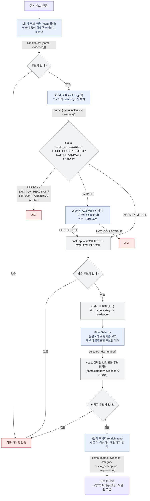
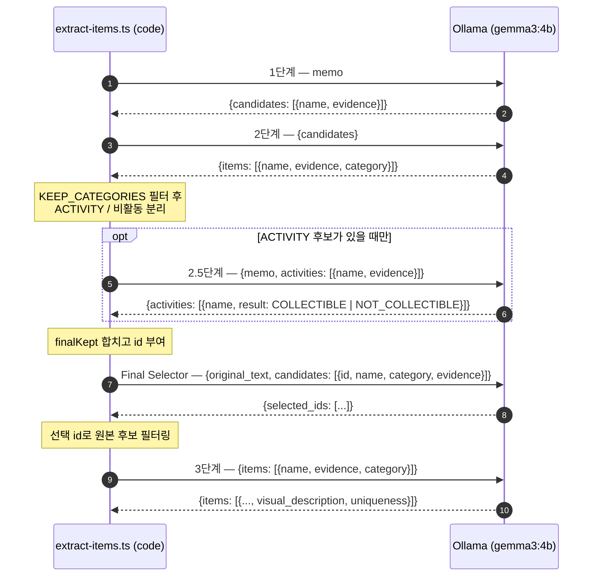
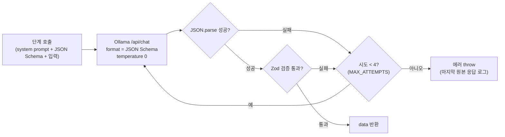
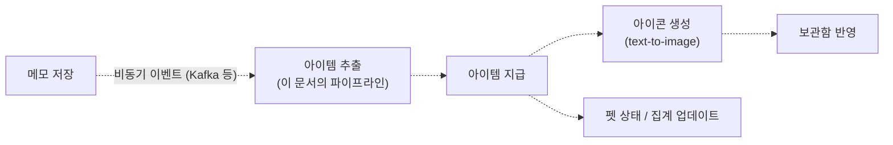

# 아이템 추출 파이프라인 (POC, v0.5.2 기준)

`poc/extract-items.ts`의 현재 흐름을 정리한다. 평가 스크립트 `poc/run-eval.ts`도 같은 파이프라인을 그대로 복제해서 돈다.
모델은 로컬 Ollama다.
- `extract-items.ts` 기본값은 `gemma3:4b`이고, `OLLAMA_MODEL`로 바꿀 수 있다.
- 평가 실험은 `gemma3:4b-it-q8_0`으로 돌렸다.

모든 LLM 단계는 같은 `callWithRetry` 루프를 쓴다.

## 1. 전체 흐름

- 파란색: LLM 호출. 회색: 코드 판정. 빨간색: 제외/종료.
- 각 단계의 책임
  - **1단계**: 모든 후보를 빠짐없이 뽑는다 (recall). 사람/감정/감각 표현도 일단 포함한다.
  - **2단계**: 의미 분류만 한다. "아이템으로 쓸 만한가"는 묻지 않는다. 유지/제외는 모델이 아니라 code가 `KEEP_CATEGORIES`로 판정한다.
  - **2.5단계**: 제품 정책(COLLECTIBLE 여부)은 여기서만 다루고, 대상은 ACTIVITY뿐이다. 전 카테고리로 넓혀 봤다가 엣지케이스가 무너져서 되돌렸다.
  - **Final Selector**: 중복 표현, 조각 표현, 잘못 자른 후보, 단순 배경을 제거한다. 새 후보를 만들거나 기존 후보를 수정하지 않고 id만 고른다.
  - **3단계**: 살아남은 아이템에 아이콘용 `visual_description`과 `uniqueness`(GENERIC / SPECIFIC / DISTINCTIVE)를 붙인다.

## 2. 단계별 입출력

## 3. 공통 호출 구조 — `callWithRetry`

모든 LLM 단계(1, 2, 2.5, Final Selector, 3)가 같은 루프를 쓴다. 로컬 모델은 스키마를 어길 때 앱이 직접 방어해야 하기 때문이다.

Final Selector는 호출할 때마다 스키마를 동적으로 만든다.
- JSON Schema: `selected_ids.items`에 `enum: [입력 id들]`
- Zod `superRefine`: **중복 id**와 **입력에 없는 id**를 거부한다. 거부되면 재시도로 이어진다.

## 4. 단계별 현재 성능 (500개, v0.5.2)

출처: `poc/eval-run-500-final-selector-v0.5.2.log`, `poc/eval-results-v0.5.2-final-selector-500.md`

| 단계 | 지표 | 값 |
|---|---|---|
| 1단계 | Candidate Recall | 551/562 (98.0%) |
| 2단계 | Category Accuracy | 492/551 (89.3%) |
| 2.5단계 | Collectibility accuracy | 80.4% |
| Final Selector | Expected Preservation / Non-expected Removal | 89.1% / 54.5% |
| 최종 | Precision / Recall / F1 | 68.2% / 76.9% / 72.3% |
| 최종 | 엣지케이스 통과 | 59/68 (86.8%) |
| 전 단계 | Schema 최종 실패 | 0 / 2,061 호출 |

## 5. 아직 이 파이프라인에 없는 것

AGENTS.md의 "시스템 파이프라인 (계획)"에 해당하는 부분은 아직 POC 범위 밖이다.

- POC에서는 동기 스크립트로 개념만 검증한다.
- 재시도 + DLQ, 멱등성, Circuit Breaker, 아이콘 생성 파이프라인은 미착수다.
- "활동 → 대표 오브젝트" 매핑(요가 → 요가매트 등)은 추출 단계에 넣지 않는다. 아이콘 생성 단계나 별도 큐레이션 테이블에서 처리한다.
